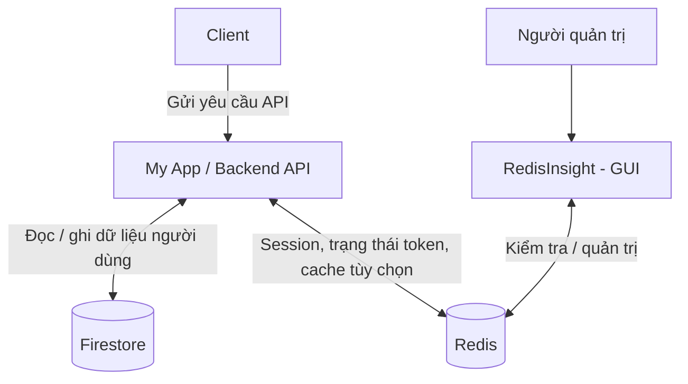

# Kiến trúc hệ thống: Backend API, Firestore và Redis

## 1. Phạm vi

Tài liệu tổng hợp kiến trúc từ sơ đồ được cung cấp: Client gọi My App (Backend API); Backend API sử dụng Firestore để lưu trữ dữ liệu người dùng và Redis để lưu session, dữ liệu phục vụ token và cache nếu cần. RedisInsight là giao diện quản trị Redis.

Sơ đồ gốc chưa chỉ định framework, nhà cung cấp xác thực, cơ chế token, cấu trúc dữ liệu hoặc môi trường triển khai. Các phần về luồng xử lý, khóa dữ liệu và vận hành dưới đây là đề xuất triển khai, chưa phải cấu hình đã được xác nhận.

## 2. Sơ đồ tổng thể



Các mũi tên hai chiều diễn tả việc đọc và ghi khi triển khai; sơ đồ gốc chỉ minh họa hướng kết nối từ ứng dụng đến nơi lưu trữ.

## 3. Thành phần và trách nhiệm

| Thành phần | Vai trò | Dữ liệu / tác vụ chính |
| --- | --- | --- |
| Client | Giao diện người dùng gửi yêu cầu đến API và nhận kết quả | Thao tác người dùng, hiển thị dữ liệu, gửi thông tin xác thực theo cơ chế được chọn |
| My App / Backend API | Điểm xử lý nghiệp vụ và truy cập dữ liệu | Kiểm tra đầu vào, xác thực, phân quyền, đọc/ghi Firestore, quản lý dữ liệu Redis |
| Firestore | Nguồn dữ liệu chính cho dữ liệu người dùng | Hồ sơ người dùng và dữ liệu nghiệp vụ cần lưu lâu dài |
| Redis | Lưu dữ liệu có thời hạn hoặc cần truy cập nhanh | Session, trạng thái phục vụ quản lý token và cache tùy chọn |
| RedisInsight | Công cụ phục vụ người quản trị / phát triển | Xem key, kiểu dữ liệu, TTL và kiểm tra hoạt động Redis |

RedisInsight không nằm trong luồng xử lý yêu cầu của Client. Backend API làm việc trực tiếp với Redis.

## 4. Phân chia dữ liệu

### 4.1. Firestore — dữ liệu chính

Đề xuất dùng collection `users`, mỗi document ứng với một `userId` ổn định.

```text
users/{userId}
    displayName
    email
    avatarUrl
    createdAt
    updatedAt
```

Các trường trên là ví dụ thiết kế, không phải cấu trúc đã có trong sơ đồ. Chỉ bổ sung dữ liệu nghiệp vụ khi xác định được yêu cầu ứng dụng. Không lưu mật khẩu dạng rõ; cách quản lý thông tin đăng nhập phụ thuộc hệ thống xác thực được chọn.

### 4.2. Redis — session, token và cache

Thiết kế chi tiết cho phương án session phía server: [Dữ liệu Redis cho quản lý phiên đăng nhập](redis-data-design.md), gồm tài khoản, chi tiết/danh sách phiên, bộ đếm đăng nhập, người dùng hoạt động và lịch sử.

| Nhóm dữ liệu | Ví dụ key đề xuất | Nội dung | Thời hạn |
| --- | --- | --- | --- |
| Session | `session:{sessionId}` | `userId`, thời điểm tạo, metadata tối thiểu | Theo thời gian sống của session |
| Refresh token, nếu sử dụng | `refresh:{tokenHash}` | `userId`, mã phiên hoặc họ token | Theo hạn của refresh token |
| Thu hồi access token, nếu cần | `revoked:{jti}` | Dấu hiệu token đã bị thu hồi | Phần thời gian còn lại của token |
| Cache hồ sơ, tùy chọn | `cache:user:{userId}` | Bản sao dữ liệu hồ sơ cho phép cache | Theo mức độ chấp nhận dữ liệu cũ |

Không bắt buộc triển khai tất cả nhóm key. Chọn session hoặc token theo yêu cầu xác thực; kết hợp chỉ khi có nhu cầu rõ ràng. Với token bí mật, đề xuất lưu giá trị băm để tra cứu thay vì lưu token thô.

Cache Redis là bản sao có thể tái tạo từ Firestore. Session và trạng thái token có ảnh hưởng trực tiếp đến xác thực nên cần chính sách độ bền và xử lý lỗi riêng, không mặc định coi chúng là cache có thể mất.

## 5. Luồng xử lý đề xuất

### 5.1. Đăng nhập

1. Client gửi yêu cầu đăng nhập đến Backend API.
2. Backend xác minh danh tính qua cơ chế xác thực được chọn; sơ đồ chưa xác định thành phần thực hiện bước này.
3. Backend đọc hoặc khởi tạo hồ sơ người dùng trong Firestore khi cần.
4. Nếu dùng session: Backend tạo session trong Redis và trả cookie chứa định danh phiên. Nếu dùng token: Backend cấp hoặc chuyển tiếp token theo cơ chế đã chọn, đồng thời ghi trạng thái Redis nếu cần.
5. Client dùng thông tin xác thực cho các yêu cầu tiếp theo.

### 5.2. Đọc thông tin người dùng

1. Client gọi API lấy hồ sơ.
2. Backend xác thực và kiểm tra quyền truy cập.
3. Nếu bật cache, Backend tìm `cache:user:{userId}` trong Redis.
4. Khi cache hợp lệ, Backend trả dữ liệu cache. Khi không có cache hoặc cache hết hạn, Backend đọc Firestore và ghi cache với TTL.
5. Backend trả dữ liệu phù hợp cho Client.

Đây là cách tổ chức cache-aside được đề xuất; ứng dụng có thể đọc trực tiếp Firestore nếu chưa cần cache.

### 5.3. Cập nhật thông tin người dùng

1. Backend xác thực, phân quyền và kiểm tra dữ liệu đầu vào.
2. Backend ghi thay đổi vào Firestore.
3. Sau khi ghi thành công, Backend xóa cache hồ sơ tương ứng nếu cache đang được sử dụng.
4. Yêu cầu đọc tiếp theo nạp dữ liệu mới từ Firestore vào cache.

Firestore và Redis không được giả định có một giao dịch chung. Nếu xóa cache thất bại, đề xuất retry có giới hạn và TTL để giới hạn thời gian giữ dữ liệu cũ. Với dữ liệu yêu cầu nhất quán tức thời, cân nhắc bỏ qua cache hoặc bổ sung cơ chế kiểm tra phiên bản.

### 5.4. Đăng xuất

- Với session: xóa session trong Redis và xóa cookie phía Client.
- Với token: thu hồi refresh token nếu có, xóa thông tin xác thực phía Client và áp dụng cơ chế thu hồi access token nếu yêu cầu nghiệp vụ cần hiệu lực ngay.
- Việc chỉ xóa token phía Client không tự làm mất hiệu lực một access token còn hạn ở phía server.

## 6. Xử lý khi dịch vụ gặp lỗi

| Tình huống | Hành vi đề xuất |
| --- | --- |
| Redis cache không khả dụng | Đọc trực tiếp Firestore trong giới hạn tải cho phép; ghi nhận lỗi cache |
| Redis lưu session không khả dụng | Trả lỗi dịch vụ tạm thời cho các yêu cầu cần kiểm tra phiên; không bỏ qua xác thực |
| Redis quản lý thu hồi token không khả dụng | Áp dụng chính sách đã định cho endpoint được bảo vệ; không tự bỏ qua kiểm tra thu hồi |
| Firestore không khả dụng | Trả lỗi phù hợp cho thao tác cần dữ liệu chính; chỉ phục vụ cache cũ khi nghiệp vụ cho phép |
| RedisInsight không khả dụng | Backend vẫn hoạt động nếu Redis và các dịch vụ phụ thuộc khác hoạt động bình thường |

## 7. Nguyên tắc triển khai đề xuất

- Client gọi Backend API; quyền truy cập Firestore và Redis được kiểm soát ở phía server trong kiến trúc này.
- Truyền thông qua HTTPS cho Client–API; bảo vệ kết nối và thông tin xác thực tới các dịch vụ lưu trữ.
- Cấu hình cookie `HttpOnly`, `Secure` và `SameSite` phù hợp nếu sử dụng cookie; bổ sung bảo vệ CSRF theo cách sử dụng cookie.
- Giữ thông tin kết nối và bí mật trong biến môi trường hoặc hệ thống quản lý secrets.
- Giới hạn Redis và RedisInsight trong mạng / phạm vi quản trị được phép truy cập.
- Đặt TTL rõ ràng cho session, trạng thái token có hạn và cache; không ghi token bí mật vào log.
- Tách dữ liệu xác thực và cache bằng instance Redis riêng hoặc cấu hình vận hành bảo vệ dữ liệu xác thực khỏi bị đẩy ra khi thiếu bộ nhớ. Chỉ dùng prefix key không bảo đảm cách ly tài nguyên.
- Theo dõi độ trễ API, lỗi Firestore/Redis, bộ nhớ Redis và tỷ lệ cache hit/miss nếu bật cache.

## 8. Những quyết định còn cần chốt

| Hạng mục | Cần xác định |
| --- | --- |
| Backend | Ngôn ngữ, framework và cấu trúc module |
| Xác thực | Nhà cung cấp xác thực, session hay token, thời hạn và cơ chế thu hồi |
| Firestore | Collection, trường dữ liệu, index, quyền truy cập và sao lưu |
| Redis | Môi trường triển khai, TTL, persistence, chính sách bộ nhớ và phục hồi |
| Cache | Endpoint cần cache, thời gian cho phép dữ liệu cũ và cách vô hiệu hóa cache |
| Triển khai | Hosting API, mạng kết nối, quản lý secrets và quyền quản trị RedisInsight |

## 9. Nguồn

Sơ đồ đính kèm: `image(20261026-041745).png`. Tài liệu giữ nguyên các thành phần trong ảnh; các chi tiết triển khai bổ sung được trình bày dưới dạng đề xuất.
