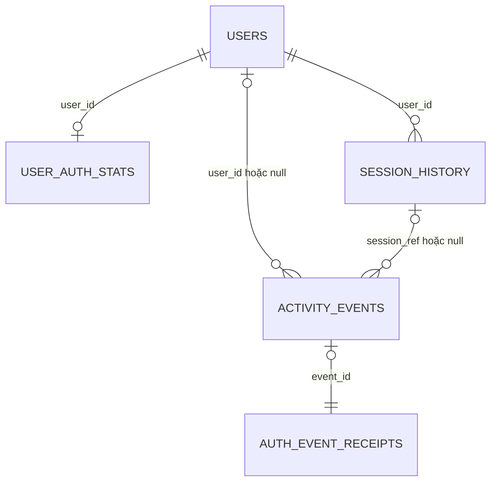

# Thiết kế dữ liệu Firestore cho tài khoản và quản lý đăng nhập

## 1. Vai trò và nguyên tắc

Thiết kế này bổ sung cho [mô hình Redis](redis-data-design.md) và [kiến trúc hệ thống](architecture.md). Phạm vi là Cloud Firestore Native mode, truy cập qua Backend API và worker. Đây là đặc tả đề xuất; chưa tạo database, index hoặc backend trên Firebase.

| Dữ liệu | Nguồn quyết định | Vai trò Firestore | Vai trò Redis |
| --- | --- | --- | --- |
| Hồ sơ, trạng thái tài khoản | Firestore / nhà cung cấp xác thực | Lưu dữ liệu gốc | Cache hiển thị 15 phút |
| Phiên còn hiệu lực | Redis | Lưu lịch sử và bản chiếu có độ trễ | Kiểm tra phiên, TTL, thu hồi |
| Danh sách phiên hiện tại | Redis | Tra cứu lịch sử các thiết bị từng đăng nhập | Danh sách sid chưa hết hạn |
| Tổng thành công / sai lâu dài | Sự kiện đã lưu bền | Tổng sự kiện đã xử lý, chống đếm trùng | Bộ đếm nhanh, có thể mới hơn Firestore |
| Người dùng đang online | Redis | Lưu lần hoạt động gần nhất theo đợt | Presence thời gian gần thực |
| Lịch sử hoạt động | Firestore sau khi worker xác nhận | Lưu lâu dài, lọc và phân trang | Stream gần đây và hàng đợi xuất dữ liệu |

Không dùng document lịch sử phiên để cấp lại quyền truy cập khi Redis mất phiên. Không suy ra online từ `users.status`, vì `active` là tài khoản được phép sử dụng, khác với đang hoạt động.

Quy ước chung:

- Document ID của user chính là `uid` ổn định; khớp mọi key Redis có uid.
- Dùng `snake_case` để thống nhất field với Redis. Thay các field minh họa `displayName`, `createdAt` trong kiến trúc cũ bằng `display_name`, `created_at` ở thiết kế triển khai này.
- Thời gian trong Firestore là **Timestamp**; worker chuyển Redis milliseconds sang Timestamp. `occurred_at` giữ thời điểm gốc; `ingested_at`, `updated_at` dùng server timestamp khi ghi Firestore.
- ID sự kiện là UUID ngẫu nhiên do backend tạo. ID lịch sử phiên là `session_ref = HMAC-SHA256(reference_key, sid)` đầy đủ, ổn định suốt phiên; tách khóa tham chiếu khỏi khóa HMAC định danh đăng nhập.
- Không lưu secret cookie, mật khẩu rõ, access token hoặc refresh token thô trong bất kỳ document nào.
- Không nhúng mảng phiên hoặc toàn bộ lịch sử vào document user; mỗi bản ghi là document riêng để phân trang và tránh document tăng không giới hạn.

## 2. Cấu trúc collections

```text
users/{uid}                         Hồ sơ và trạng thái tài khoản gốc
user_auth_stats/{uid}               Tổng đăng nhập, sai, mốc hoạt động đã đồng bộ
session_history/{session_ref}       Một document cho một phiên từng được tạo
activity_events/{event_id}          Một document cho một sự kiện
system_auth_stats/total             Tổng toàn hệ thống (quy mô demo)
auth_event_receipts/{event_id}       Dấu đã áp dụng sự kiện, chống đếm lại
auth_sync_checkpoints/{source_id}   Vị trí worker đã xử lý trong từng Stream
```

Các collection đều ở cấp gốc. Tạo document không tạo quan hệ khóa ngoại tự động; backend/worker kiểm tra uid và phân quyền. Khi xóa user phải có quy trình xóa/ẩn danh các document liên quan.



Receipt có thể còn tồn tại sau khi event đã hết thời hạn lưu. Các quan hệ trong sơ đồ do ứng dụng quản lý.

## 3. Chi tiết documents

### 3.1. `users/{uid}` — thông tin tài khoản gốc

| Field | Kiểu | Nội dung / ràng buộc |
| --- | --- | --- |
| `user_id` | string | Bằng document ID |
| `username` | string hoặc null | Tên đăng nhập nếu ứng dụng hỗ trợ |
| `display_name` | string | Tên hiển thị |
| `email` | string hoặc null | Email hồ sơ từ nguồn xác thực |
| `email_verified` | boolean | Do nguồn xác thực xác nhận |
| `avatar_url` | string hoặc null | Ảnh đại diện |
| `status` | string | `active`, `locked`, `disabled` |
| `auth_provider` | string | Ví dụ `firebase_auth`, `internal`, ... |
| `auth_subject` | string | ID định danh bên nhà cung cấp; không phải token |
| `created_at` | Timestamp | Lúc tạo tài khoản |
| `updated_at` | Timestamp | Lần thay đổi hồ sơ gần nhất |
| `status_changed_at` | Timestamp | Lần thay đổi trạng thái gần nhất |
| `schema_version` | integer | `1` |

Ánh xạ cache Redis: `updated_at` → `profile_updated_at`, các field còn lại cùng tên nếu có; thêm `cached_at` lúc nạp cache. Trường email, username cần cùng một quy tắc chuẩn hóa ở nguồn xác thực. Truy vấn `where email == ...` không tự bảo đảm duy nhất khi hai đăng ký đồng thời; nếu hỗ trợ đăng nhập bằng email/username phải dùng ràng buộc của nhà cung cấp hoặc collection giữ chỗ định danh riêng với thao tác tạo nguyên tử.

Thiết kế chưa chốt nhà cung cấp xác thực. Nếu dùng Firebase Authentication, thông tin mật khẩu do dịch vụ đó quản lý. Nếu tự xác thực, phải có kho credential backend riêng với mật khẩu băm theo chính sách xác thực; không đặt credential vào document hồ sơ/cache này.

### 3.2. `session_history/{session_ref}` — chi tiết và lịch sử phiên

| Field | Kiểu | Nội dung |
| --- | --- | --- |
| `session_ref` | string | Bằng document ID, ánh xạ ổn định với phiên Redis |
| `user_id` | string | Chủ phiên |
| `status` | string | `open`, `logged_out`, `revoked`, `expired`, `missing`, `invalidated` |
| `created_at` | Timestamp | Từ sự kiện tạo phiên |
| `last_seen_at` | Timestamp | Lần hoạt động gần nhất đã lấy mẫu |
| `expires_at` | Timestamp | Hạn idle gần nhất đã đồng bộ |
| `absolute_expires_at` | Timestamp | Hạn tuyệt đối ban đầu |
| `ended_at` | Timestamp hoặc null | Thời điểm kết thúc thực tế đã biết |
| `end_reason` | string hoặc null | Ví dụ `user_logout`, `admin_revoke`, `idle_timeout` |
| `auth_method` | string | Cách xác thực |
| `ip_created` | string hoặc null | IP tạo phiên, có thể giảm chi tiết |
| `ip_last` | string hoặc null | IP gần nhất được lấy mẫu |
| `user_agent` | string hoặc null | Chuỗi giới hạn độ dài, không dùng để cấp quyền |
| `device_name` | string | Ví dụ `Chrome / Windows` |
| `creation_event_id` | string hoặc null | Sự kiện tạo phiên |
| `last_event_id` | string | Sự kiện cập nhật bản chiếu gần nhất |
| `source_epoch` | string | Thế hệ dữ liệu Redis, xem mục 5 |
| `source_stream_id` | string | Vị trí nguồn đã áp dụng |
| `ingested_at` | Timestamp | Lúc tạo document Firestore |
| `updated_at` | Timestamp | Lúc cập nhật document Firestore |
| `expire_at` | Timestamp hoặc null | Thời điểm được phép xóa theo chính sách lưu trữ |
| `schema_version` | integer | `1` |

`open` nghĩa là chưa lưu được sự kiện kết thúc; không khẳng định phiên hiện còn hợp lệ. Không tự đổi sang `expired` chỉ dựa trên `expires_at` đã lưu vì heartbeat mới có thể chưa đồng bộ. API “phiên đang đăng nhập” đọc Redis; API “lịch sử phiên” đọc collection này.

Không lưu sid băm dùng tra phiên Redis trong response API. Backend muốn thu hồi qua `session_ref` sẽ duyệt tối đa 5 sid hiện hành của đúng uid trong Redis và tính lại HMAC để tìm phiên tương ứng.

### 3.3. `user_auth_stats/{uid}` — thống kê lưu bền theo user

| Field | Kiểu | Quy tắc |
| --- | --- | --- |
| `user_id` | string | Bằng document ID |
| `login_success_total` | integer | +1 cho mỗi sự kiện `login_success` chưa áp dụng |
| `login_failed_total` | integer | +1 cho `login_failed` của uid đã xác định |
| `last_login_at` | Timestamp hoặc null | Max occurred_at của đăng nhập thành công |
| `last_failed_login_at` | Timestamp hoặc null | Max occurred_at của đăng nhập sai |
| `last_activity_at` | Timestamp hoặc null | Max last_seen_at của hoạt động xác thực đã đồng bộ |
| `counting_started_at` | Timestamp | Mốc bắt đầu cùng phạm vi với Redis |
| `updated_at` | Timestamp | Lần worker cập nhật |
| `schema_version` | integer | `1` |

Không reset tổng lỗi sau khi đăng nhập thành công. Không TTL collection này. Không dùng mốc mới nhất của user làm checkpoint cho mọi Stream: mỗi nguồn có tiến độ riêng ở `auth_sync_checkpoints`.

### 3.4. `system_auth_stats/total` — tổng hệ thống

Field: `login_success_total`, `login_failed_total`, `login_failed_unknown_total` (integer), `counting_started_at`, `updated_at` (Timestamp), `schema_version` (integer).

Quy tắc khớp Redis: `login_failed_total` bao gồm cả tài khoản không xác định; `login_failed_unknown_total` là tập con đó. Lỗi hệ thống, bị chặn tốc độ, tài khoản khóa hoặc vượt giới hạn phiên ghi `login_denied`, không tăng tổng sai thông tin xác thực. Tổng thành công tăng khi tạo được phiên, kể cả phản hồi cookie sau đó bị mất trên mạng.

Một document tổng là lựa chọn đơn giản cho project demo. Khi contention/tải tăng, chuyển sang bộ đếm phân mảnh với shard được chọn ổn định từ event ID, receipt và cập nhật shard cùng transaction; API tổng hợp các shard. Không ghi mỗi heartbeat vào document tổng.

### 3.5. `activity_events/{event_id}` — lịch sử hoạt động lâu dài

| Field | Kiểu | Nội dung |
| --- | --- | --- |
| `event_id` | string | Bằng document ID |
| `event_type` | string | Loại sự kiện trong tài liệu Redis |
| `user_id` | string hoặc null | null khi đăng nhập với định danh không tồn tại |
| `session_ref` | string hoặc null | Tham chiếu phiên; null khi chưa tạo phiên |
| `occurred_at` | Timestamp | Thời điểm hành động ở Redis/backend |
| `ingested_at` | Timestamp | Thời điểm Firestore tiếp nhận |
| `result` | string | `success`, `failure`, `denied` |
| `reason` | string hoặc null | Mã lý do an toàn |
| `ip` | string hoặc null | IP theo chính sách lưu trữ |
| `device_name` | string hoặc null | Nhãn thiết bị |
| `request_id` | string | ID theo dõi request |
| `identifier_digest` | string hoặc null | HMAC định danh; chỉ cần cho lỗi unknown |
| `source_epoch` | string | Thế hệ dữ liệu nguồn |
| `source_stream_key` | string | Key Stream gốc, chỉ backend đọc |
| `source_stream_id` | string | ID entry Redis `<ms>-<seq>` |
| `payload` | map | Metadata đã cho phép theo từng loại sự kiện |
| `expire_at` | Timestamp hoặc null | Hạn lưu trữ |
| `schema_version` | integer | `1` |

Ví dụ document ở dạng biểu diễn, `Timestamp(...)` không phải chuỗi được lưu:

```text
activity_events/550e8400-e29b-41d4-a716-446655440000
  event_id: "550e8400-e29b-41d4-a716-446655440000"
  event_type: "login_success"
  user_id: "u001"
  session_ref: "<HMAC đầy đủ của sid>"
  occurred_at: Timestamp(2026-10-26T08:00:00Z)
  ingested_at: serverTimestamp()
  result: "success"
  reason: null
  device_name: "Chrome / Windows"
  source_epoch: "<UUID thế hệ Redis>"
  source_stream_key: "auth:user:u001:activities"
  source_stream_id: "1793001600000-0"
  payload:
    created_at_ms: 1793001600000
    last_seen_at_ms: 1793001600000
    expires_at_ms: 1793003400000
    absolute_expires_at_ms: 1793606400000
    auth_method: "password"
    user_agent: "<User-Agent đã giới hạn chiều dài>"
  schema_version: 1
```

Các field metadata không bắt buộc có thể null; worker không tự suy diễn giá trị bị thiếu. Lịch sử đầu vào là bất biến: gặp lại event ID thì xác minh cùng nội dung nghiệp vụ; không ghi đè một event cũ bằng dữ liệu khác.

### 3.6. `auth_event_receipts/{event_id}` — chống áp dụng trùng

Field: `applied_at` (Timestamp), `payload_hash` (string, SHA-256 trên biểu diễn chuẩn hóa của nội dung nghiệp vụ), `schema_version` (integer). Không cần lưu PII hoặc uid trong receipt. Hash không bao gồm `ingested_at` và vị trí vận chuyển để cùng sự kiện gửi lại vẫn nhận diện được.

Receipt được tạo cùng transaction với event, cập nhật lịch sử phiên và các bộ đếm. Giữ receipt cả khi hết hạn lưu chi tiết event để replay không làm tăng tổng lần nữa. Mặc định không TTL receipt; dung lượng tăng theo số sự kiện. Muốn xóa receipt phải đặt giới hạn replay được kiểm soát và lưu checkpoint/tổng bền tương ứng trước, không xóa chỉ vì event đã hết hạn.

### 3.7. `auth_sync_checkpoints/{source_id}` — tiến độ đồng bộ

`source_id = SHA-256(source_epoch + ":" + source_stream_key)`; không dùng key Redis chứa dấu `/` hoặc dữ liệu tùy ý làm đường dẫn Firestore.

Field: `source_epoch`, `source_stream_key`, `last_stream_id` (string), `last_event_id` (string), `updated_at` (Timestamp), `schema_version` (integer). Không TTL khi nguồn còn khả năng replay.

Khi so thứ tự Stream ID, tách `<ms>-<seq>` thành hai số nguyên 64 bit và so từng thành phần; không so chuỗi từ điển hoặc chuyển toàn bộ ID thành số dấu phẩy động. Checkpoint chỉ tiến sau entry đã áp dụng, không tiến qua entry lỗi.

`source_epoch` là UUID do vận hành cấu hình cho một thế hệ dữ liệu Redis. Mọi producer ghi epoch vào entry. Khi thay thế/khôi phục Redis hoặc tạo lại Stream làm mất lịch sử nguồn, đổi epoch; không reset Stream rồi dùng lại checkpoint cũ. Các entry tồn đọng của epoch cũ vẫn phải được xử lý hoặc ghi nhận khoảng mất dữ liệu rõ ràng.

## 4. Ánh xạ đầy đủ với Redis

| Redis | Firestore | Cách đồng bộ |
| --- | --- | --- |
| `auth:account:<uid>` | `users/<uid>` | Firestore → cache, đổi hồ sơ thì vô hiệu hóa cache |
| `auth:session:<sid>` | `session_history/<session_ref>` | Sự kiện tạo/kết thúc và snapshot hoạt động → bản chiếu |
| `auth:user:<uid>:sessions` | Query session_history theo user_id | Chỉ danh sách lịch sử tương ứng; không dùng thay index phiên sống |
| `auth:user:<uid>:stats` | `user_auth_stats/<uid>` | Cùng sự kiện đăng nhập; Firestore có thể trễ |
| `auth:stats` | `system_auth_stats/total` | Tổng từ sự kiện chưa áp dụng |
| Presence và online users | `user_auth_stats.last_activity_at` | Lưu mốc lấy mẫu, không lưu cờ online có thẩm quyền |
| Stream user và unknown | `activity_events/<event_id>` | Worker lưu sự kiện, receipt và checkpoint |
| Bộ đếm thử sai cửa sổ | Không lưu bản sao thường xuyên | Redis TTL 15 phút; event sai vẫn được lưu lâu dài |
| `auth:login-op:<operation_id>` | Không thay bằng receipt | Operation chống xử lý lặp login; receipt chống áp dụng lặp ở worker |

Không sao chép cả Hash Redis theo định kỳ rồi ghi đè tổng Firestore: worker có thể đọc snapshot giữa lúc nhiều login đang chạy, gây đếm thiếu hoặc đếm hai lần. Hai bên phải cùng định nghĩa tổng và phạm vi `counting_started_at`.

## 5. Đồng bộ Stream → Firestore

### 5.1. Bổ sung hợp đồng sự kiện

Để đủ thông tin tái dựng lịch sử phiên, producer Redis cần gửi:

- Mọi sự kiện: field chuẩn ở mục 3.5 và `source_epoch`.
- `login_success`: payload đầy đủ snapshot tạo phiên gồm created/last_seen/expires/absolute_expires, phương thức xác thực và thiết bị; IP theo chính sách cho phép.
- `logout`, `session_revoked`, `session_expired`, `session_missing`: cùng `session_ref`, thời điểm kết thúc và lý do; có snapshot cuối nếu Hash còn tồn tại.
- `session_snapshot`: snapshot last_seen/expires/IP gần nhất được lấy mẫu tối đa một lần mỗi 5 phút mỗi phiên đang hoạt động, kèm một snapshot khi kết thúc nếu có thể. Sự kiện này không tăng số lần đăng nhập; dùng để cập nhật session_history và last_activity_at.

Tất cả thay đổi phiên và sự kiện của một user phải đi cùng Stream user trong thứ tự thao tác Redis. Snapshot được tạo từ Hash đã xác thực, không lấy thông tin phiên do client tự khai. Không cần ghi Firestore trực tiếp sau mỗi heartbeat; mốc hoạt động lưu bền có độ trễ lấy mẫu cộng độ trễ worker. Gửi snapshot định kỳ khi có hoạt động, không phụ thuộc vào việc user logout.

### 5.2. Một transaction cho một sự kiện

1. Worker đọc checkpoint của Stream, lấy entry sau `last_stream_id`, xử lý tuần tự trong mỗi nguồn. Có thể xử lý các user khác nhau đồng thời.
2. Kiểm tra schema, uid so với nguồn Stream, payload và event ID. Sự kiện lỗi không được âm thầm bỏ qua; cảnh báo và giữ nguyên checkpoint để sửa/replay.
3. Trong Firestore transaction, **đọc tất cả document cần dùng trước khi ghi**: checkpoint, receipt, event hiện có, tài khoản nếu cần, thống kê và session liên quan. Kiểm tra checkpoint vẫn là vị trí worker đã dùng; nếu worker khác đi trước thì tải lại nguồn từ checkpoint mới.
4. Nếu receipt đã có và payload_hash khớp: không tăng tổng, không áp dụng lại projection; chỉ tiến checkpoint nếu phù hợp thứ tự nguồn. Receipt/hash không khớp thì dừng vì xung đột event ID. Nếu receipt thiếu mà event đã tồn tại, coi là trạng thái bất thường cần đối soát, không tự cộng lại.
5. Nếu chưa xử lý: tạo event và receipt; cập nhật thống kê theo loại; cập nhật session_history; cập nhật checkpoint trong cùng transaction.
6. Khi commit thành công mới cho phép worker tiến nguồn hoặc trim Redis đến đoạn đã xác nhận. Nếu mất kết nối sau commit, chạy lại bước 3 an toàn nhờ receipt.

Transaction Firestore có thể chạy lại callback khi dữ liệu đọc bị thay đổi. Không gọi Redis, gửi cookie, tăng số bên ngoài hay thực hiện side effect trong callback. Các lần đọc phải đứng trước ghi, theo [tài liệu transactions](https://firebase.google.com/docs/firestore/manage-data/transactions).

Không có transaction chung Firestore–Redis. Nếu Redis mất trước khi worker lưu, sự kiện chưa xuất có thể mất. Yêu cầu audit không mất sự kiện cần journal bền được xác nhận trước phản hồi đăng nhập, như giới hạn đã nêu trong thiết kế Redis.

### 5.3. Quy tắc cập nhật bản chiếu

- `login_success`: tạo session_history/open và tăng tổng thành công một lần. Snapshot không tạo một “lần đăng nhập” mới.
- `login_failed`: tăng tổng hệ thống; có uid thì tăng tổng user, không có uid thì tăng tổng unknown; không tạo session_history.
- `session_snapshot`: cập nhật last_seen/expires từ sự kiện mới hơn trong cùng Stream. Không mở lại session đã có trạng thái kết thúc.
- Sự kiện kết thúc: chuyển trạng thái, đặt ended_at/end_reason. Không xóa document lịch sử ngay khi Redis xóa Hash.
- Cập nhật các field `last_*` theo max thời điểm nghiệp vụ để sự kiện đến trễ không làm thời gian lùi lại. Giữ nguyên `counting_started_at` theo mốc khởi tạo, không đặt lại theo thời điểm replay.
- Redis và Firestore không đương nhiên bằng nhau tại cùng thời điểm. API quản trị phải hiển thị thống kê lưu bền có độ trễ; tiến độ từng nguồn nằm ở checkpoints.
- Sau phục hồi thảm họa, vô hiệu hóa phiên cũ trước khi mở dịch vụ. Worker đối soát chuyển các bản chiếu open thuộc nguồn đã bị thay thế sang `invalidated`, không khôi phục cookie từ Firestore.

Muốn tái dựng Redis stats từ Firestore phải có giai đoạn bảo trì hoặc hàng rào đồng bộ: ngừng ghi mới, xử lý hết backlog còn truy cập được, nạp tổng và mốc thời gian, chuyển sang epoch mới rồi tiếp nhận login. Không vừa nạp tổng cũ vừa cộng lại các event đã được tính. Ghi rõ khoảng mất dữ liệu nếu nguồn bị mất trước khi xuất.

## 6. Truy vấn và indexes

| Màn hình / thao tác | Truy vấn Firestore | Index dự kiến |
| --- | --- | --- |
| Hồ sơ / tổng theo user | Đọc thẳng users/uid, user_auth_stats/uid | Document ID |
| Lịch sử phiên user | user_id == uid, orderBy created_at DESC, limit 20 | user_id ASC + created_at DESC |
| Phiên theo trạng thái lưu bền | user_id == uid, status == ..., orderBy created_at DESC | user_id ASC + status ASC + created_at DESC |
| Lịch sử hoạt động user | user_id == uid, orderBy occurred_at DESC, limit 20 | user_id ASC + occurred_at DESC |
| Lọc loại hoạt động user | user_id == uid, event_type == ..., orderBy occurred_at DESC | user_id ASC + event_type ASC + occurred_at DESC |
| Xem lịch sử một phiên | user_id == uid, session_ref == ref, orderBy occurred_at DESC | user_id ASC + session_ref ASC + occurred_at DESC |
| Quản trị lọc sự kiện toàn hệ thống | event_type == ..., orderBy occurred_at DESC | event_type ASC + occurred_at DESC |

Phân trang bằng cursor document snapshot (`startAfter`) trên cùng filter/order, không dùng offset tăng dần. Backend kiểm tra quyền sở hữu; không cho user tự truyền uid khác để truy vấn. Cờ online và số phiên còn hiệu lực đọc Redis.

File [firestore.indexes.json](firestore.indexes.json) đi kèm là cấu hình index đề xuất cho các truy vấn trên. Miễn index các payload/metadata và TTL field không dùng để lọc; chỉ bổ sung index cho truy vấn thực tế, theo [tài liệu indexes](https://firebase.google.com/docs/firestore/query-data/index-overview). Chưa deploy các index này.

## 7. Lưu trữ, phân quyền và xóa dữ liệu

- Mặc định đề xuất: activity_events giữ 365 ngày từ occurred_at; session_history giữ 365 ngày sau ended_at. Phiên open chưa có kết thúc không tự đặt TTL; worker đối soát các phiên bỏ sót. Các thời hạn cần chốt theo yêu cầu project.
- `expire_at` phải là Timestamp; bật TTL policy riêng cho activity_events và session_history sau khi duyệt chính sách. Index JSON chỉ miễn index field, không tự bật TTL policy.
- TTL Firestore xóa bất đồng bộ, thường trong 24 giờ sau hạn; document quá hạn có thể vẫn xuất hiện. API áp dụng chính sách ẩn dữ liệu quá hạn, đọc bù theo cursor nếu một trang bị lọc bớt. TTL không dùng để chặn phiên hay xác thực. Xem [Firestore TTL](https://firebase.google.com/docs/firestore/ttl).
- user_auth_stats, system_auth_stats, receipts và checkpoints không tự hết hạn. Xóa lịch sử chi tiết không trừ bộ đếm tổng đã tính.
- Backend là đường truy cập duy nhất. Thiết kế Rules cho client trực tiếp là mặc định deny; service account của API/worker dùng IAM tối thiểu cần thiết. Backend vẫn phải xác thực cookie và quyền đọc/sửa, không coi credential server là quyền của người dùng.
- API hồ sơ chỉ trả các field được phép; không công khai receipt, checkpoint, source key, digest, IP của user khác hoặc dữ liệu credential.
- Xóa tài khoản: chặn đăng nhập và thu hồi phiên, dừng/đánh dấu luồng ingestion cho uid để sự kiện đến trễ không tái tạo dữ liệu đã xóa; drain backlog theo chính sách, rồi xóa/ẩn danh users, user stats, session history và events ở cả hai kho. Khóa luồng bằng tombstone backend được giữ ít nhất hết thời gian replay. Receipt có thể giữ dạng không PII để chống đếm lại.
- Thống kê hệ thống mặc định giữ tổng lịch sử dù user bị xóa; nếu chính sách yêu cầu điều chỉnh phải có tác vụ đối soát riêng, không trừ lặp mỗi lần worker chạy lại.

## 8. Kiểm tra khi triển khai

| Tình huống | Kết quả mong đợi |
| --- | --- |
| Một login thành công xuất sang Firestore | Có event, receipt, session, tổng user/hệ thống +1 |
| Worker xử lý lại cùng event | Tổng không đổi; checkpoint có thể tiến an toàn |
| Cùng event ID với payload khác | Báo xung đột, không ghi đè hoặc tăng tổng |
| Sai định danh không tồn tại | user_id null, tăng tổng lỗi/unknown, không tạo user giả |
| Session snapshot được xuất | Cập nhật last_seen/expires, không tăng số lần đăng nhập |
| Logout rồi snapshot cũ bị gửi lại | Phiên không chuyển lại open |
| Redis đã xóa phiên, Firestore vẫn open | API xác thực vẫn từ chối; bản chiếu chờ đối soát |
| TTL xóa event cũ rồi nguồn replay | Receipt chặn việc tăng tổng lần hai |
| Hai worker cùng xử lý một Stream | Transaction/checkpoint ngăn bỏ sót hoặc tiến lùi cursor |
| Transaction Firestore bị retry | Không phát sinh thao tác Redis hoặc side effect trùng |
| Xóa user rồi sự kiện cũ tới | Không tái tạo hồ sơ/lịch sử cá nhân đã xóa |
| Redis được khôi phục từ backup | Đổi source epoch, vô hiệu hóa phiên cũ và đối soát lịch sử |
