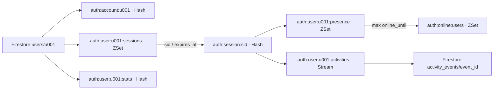

# Thiết kế dữ liệu Redis cho quản lý phiên đăng nhập

## 1. Phạm vi và quy ước

Thiết kế đề xuất cho Backend API + Firestore + Redis trong [kiến trúc hệ thống](architecture.md). Dùng **session phía server**, cookie chứa mã phiên ngẫu nhiên. Tài liệu là đặc tả dữ liệu và luồng xử lý, chưa phải backend đã triển khai.

Thiết kế lưu bền tương ứng: [Firestore cho tài khoản, lịch sử phiên, hoạt động và thống kê](firestore-data-design.md), gồm ánh xạ collections, transaction chống đếm trùng và checkpoint worker.

- Firestore giữ tài khoản gốc, trạng thái tài khoản, dữ liệu xác thực theo nhà cung cấp và lịch sử cần lưu lâu dài. Redis giữ phiên, bản sao thông tin tài khoản, bộ đếm và lịch sử gần đây.
- Mục tiêu ban đầu: Redis 7+ với một primary; có thể thêm replica/Sentinel. Chưa áp dụng trực tiếp các thao tác nhiều key cho Redis Cluster.
- Key có prefix `auth:`; `uid` là ID tài khoản ổn định từ Firestore. Các dấu `<...>` là tham số cần thay thế, không phải ký tự trong key.
- Mọi thời điểm là Unix milliseconds UTC; giao diện chuyển sang `Asia/Ho_Chi_Minh`. `now` lấy từ Redis `TIME` trong thao tác ghi để tránh lệch giờ giữa các backend.
- Sinh secret phiên bằng bộ sinh số ngẫu nhiên mật mã, tối thiểu 32 byte. Cookie giữ secret; Redis chỉ giữ `sid = SHA-256(secret)`. Không đưa secret vào URL, log hoặc RedisInsight.
- Các giá trị thời hạn bên dưới là mặc định đề xuất có thể cấu hình.

## 2. Danh mục key

| Yêu cầu | Key | Kiểu Redis | Giá trị / score | Vòng đời |
| --- | --- | --- | --- | --- |
| Thông tin tài khoản | `auth:account:<uid>` | Hash | Hồ sơ tài khoản được cache | TTL 15 phút |
| Chi tiết phiên | `auth:session:<sid>` | Hash | Chủ phiên, thiết bị, IP, thời gian | Hết hạn do không hoạt động hoặc hạn tuyệt đối |
| Danh sách phiên người dùng | `auth:user:<uid>:sessions` | Sorted Set | member = sid; score = expires_at | Dọn phiên hết hạn khi đọc/ghi và bằng worker |
| Tổng số lần đăng nhập / sai | `auth:user:<uid>:stats` | Hash | Bộ đếm và các mốc gần nhất | Không TTL; lưu bền theo mục 7 |
| Thống kê toàn hệ thống | `auth:stats` | Hash | Bộ đếm tổng cho mọi tài khoản | Không TTL; lưu bền theo mục 7 |
| Phiên đang hoạt động | `auth:user:<uid>:presence` | Sorted Set | member = sid; score = online_until | Dọn member có score <= now |
| Người dùng đang hoạt động | `auth:online:users` | Sorted Set | member = uid; score = max online_until của user | Dọn member có score <= now |
| Lịch sử hoạt động người dùng | `auth:user:<uid>:activities` | Stream | Các sự kiện theo thời gian | Giữ gần đây, xuất lưu bền trước khi xóa |
| Lịch sử đăng nhập không xác định tài khoản | `auth:unknown:activities` | Stream | Thất bại không có uid | Giới hạn lưu trữ giống lịch sử user |
| Chống thử sai theo định danh | `auth:fail:identifier:<digest>` | String số nguyên | Số lỗi trong cửa sổ 15 phút | TTL 15 phút từ lỗi đầu tiên |
| Chống thử sai theo IP | `auth:fail:ip:<digest>` | String số nguyên | Số lỗi trong cửa sổ 15 phút | TTL 15 phút từ lỗi đầu tiên |
| Chống xử lý lặp yêu cầu đăng nhập | `auth:login-op:<operation_id>` | Hash | Kết quả, sid, uid, loại sự kiện | TTL 24 giờ |

`digest` là HMAC-SHA256 với khóa riêng của server trên định danh đăng nhập đã chuẩn hóa hoặc IP. Không dùng email thô trong key. Chỉ tạo các key này sau bước giới hạn tốc độ đầu vào để tránh tạo quá nhiều key từ dữ liệu tùy ý.

Sorted Set được chọn cho danh sách phiên thay vì Set vì cần lọc theo thời điểm hết hạn. TTL của Hash phiên **không tự xóa member** trong các Sorted Set khác; đây là trách nhiệm của ứng dụng. TTL key được Redis quản lý theo [EXPIRE](https://redis.io/docs/latest/commands/expire/).

## 3. Cấu trúc chi tiết

### 3.1. Thông tin tài khoản — Hash

Key ví dụ: `auth:account:u001`.

| Field | Ví dụ | Ý nghĩa |
| --- | --- | --- |
| `user_id` | `u001` | ID Firestore |
| `username` | `hung` | Tên đăng nhập nếu hệ thống có |
| `display_name` | `Duy Hưng` | Tên hiển thị |
| `email` | `hung@example.com` | Email từ hồ sơ gốc |
| `status` | `active` | `active`, `locked`, `disabled` |
| `created_at` | `1793000000000` | Thời điểm tạo tài khoản |
| `profile_updated_at` | `1793000000000` | Phiên bản hồ sơ theo thời gian cập nhật |
| `cached_at` | `1793000000000` | Thời điểm nạp cache |

Không lưu mật khẩu, access token hoặc refresh token thô. Cache này phục vụ hiển thị. Khi đăng nhập phải xác minh trạng thái mới nhất với nguồn xác thực/Firestore; không dùng bản sao 15 phút để quyết định tài khoản còn được đăng nhập hay không. Khi khóa tài khoản hoặc đổi mật khẩu, đồng thời thu hồi mọi phiên theo mục 5.5. Mọi đường thay đổi trạng thái phải đi qua backend có phối hợp với thao tác tạo phiên; nếu thay đổi trực tiếp trong Firestore thì không bảo đảm thu hồi tức thời.

### 3.2. Chi tiết phiên — Hash

Key: `auth:session:<sid>`; chỉ tồn tại khi phiên còn dùng được.

| Field | Kiểu logic | Ý nghĩa |
| --- | --- | --- |
| `user_id` | string | Chủ sở hữu phiên |
| `created_at` | int64 | Lúc đăng nhập thành công |
| `last_seen_at` | int64 | Request/heartbeat xác thực gần nhất |
| `absolute_expires_at` | int64 | Hạn cuối, cố định lúc tạo |
| `expires_at` | int64 | Hạn hiện tại do idle timeout và hạn tuyệt đối |
| `ip_created` | string | IP khi tạo, lấy từ kết nối/proxy tin cậy |
| `ip_last` | string | IP gần nhất |
| `user_agent` | string | User-Agent được giới hạn chiều dài |
| `device_name` | string | Nhãn hiển thị, ví dụ `Chrome / Windows` |
| `auth_method` | string | `password`, `google`, ... |
| `schema_version` | integer | `1` cho thiết kế này |

Redis lưu giá trị Hash dạng chuỗi; backend chịu trách nhiệm chuyển kiểu và kiểm tra đầu vào.

```text
idle_timeout         = 30 phút
absolute_timeout     = 7 ngày
absolute_expires_at  = created_at + 7 ngày
expires_at           = min(now + 30 phút, absolute_expires_at)
online_until         = min(now + 5 phút, expires_at)
```

Sau khi tạo/gia hạn phải gọi `PEXPIREAT auth:session:<sid> expires_at`. Cookie có `HttpOnly`, `Secure`, `SameSite` phù hợp, hạn tối đa bằng hạn tuyệt đối; server luôn kiểm tra hạn hiện tại. Có bảo vệ CSRF cho thao tác thay đổi dữ liệu dùng cookie.

Không giữ `status=expired` trong Hash đã hết hạn. Trạng thái phiên kết thúc, lý do thu hồi và metadata cần xem lại nằm trong lịch sử. Người dùng có thể có tối đa **5 phiên hợp lệ**; lần đăng nhập thứ 6 bị từ chối với lựa chọn đóng một phiên cũ. Không tính lần này là sai mật khẩu.

### 3.3. Thống kê đăng nhập — Hash

`auth:user:<uid>:stats` có các field:

| Field | Quy tắc |
| --- | --- |
| `login_success_total` | +1 khi tạo được một phiên mới sau xác thực thành công |
| `login_failed_total` | +1 khi thông tin xác thực sai và đã xác định được uid |
| `last_login_at` | Lần tạo phiên thành công gần nhất |
| `last_failed_login_at` | Lần xác thực sai gần nhất |
| `last_activity_at` | Request/heartbeat được xác thực gần nhất |
| `counting_started_at` | Thời điểm bắt đầu ghi nhận thống kê |

`auth:stats` gồm `login_success_total`, `login_failed_total`, `login_failed_unknown_total`, `counting_started_at`. Tổng thất bại hệ thống bao gồm cả định danh không tồn tại; `login_failed_unknown_total` là tập con đó. Vì vậy tổng thất bại hệ thống có thể lớn hơn tổng thất bại của các user.

Tăng số bằng `HINCRBY`, không đọc rồi ghi lại để tránh mất cập nhật khi đồng thời. Lệnh tăng một field được Redis thực hiện nguyên tử theo [HINCRBY](https://redis.io/docs/latest/commands/hincrby/).

Quy ước: refresh/heartbeat, logout và API thông thường không tăng số lần đăng nhập. Yêu cầu bị giới hạn tốc độ, tài khoản bị khóa, Redis lỗi và vượt số phiên có sự kiện riêng; không gộp vào lỗi sai thông tin xác thực. Đăng nhập thành công không đặt lại `login_failed_total`. Bộ đếm cửa sổ giới hạn tốc độ tách biệt với bộ đếm tổng.

### 3.4. Theo dõi người dùng hoạt động

“Đang hoạt động” nghĩa là có ít nhất một phiên hợp lệ gửi request/heartbeat được xác thực trong 5 phút gần nhất. Đây là tín hiệu gần đúng theo heartbeat, không bảo đảm người dùng đang nhìn màn hình. Client gửi heartbeat mỗi 60 giây khi ứng dụng hiển thị; heartbeat cũng gia hạn idle timeout. Nếu muốn buộc người dùng thao tác thật mới gia hạn, phải thay đổi riêng chính sách heartbeat.

- Mỗi phiên có score `online_until` trong `auth:user:<uid>:presence`.
- Score của user trong `auth:online:users` bằng score lớn nhất của các phiên còn online.
- Khi logout một thiết bị, xóa member sid rồi tính lại score từ các phiên còn lại. Không xóa user khỏi online nếu vẫn còn phiên khác online.
- Online yêu cầu `score > now`; `score = now` đã offline. Đếm bằng `ZCOUNT auth:online:users (now +inf`, với `now` được thay bằng số thực tế.
- Kiểm tra Hash phiên là bắt buộc khi xác thực. Chỉ mục online không cấp quyền truy cập và cần đối soát nếu phiên bị mất ngoài luồng chuẩn.

### 3.5. Lịch sử hoạt động — Stream

Key: `auth:user:<uid>:activities`. Mỗi entry gồm:

| Field | Nội dung |
| --- | --- |
| `event_id` | UUID do backend tạo, dùng chống ghi trùng khi lưu bền |
| `event_type` | Loại sự kiện bên dưới |
| `user_id` | uid; rỗng với tài khoản không xác định |
| `session_ref` | Mã tham chiếu hiển thị đã dẫn xuất từ sid; không chứa secret cookie |
| `source_epoch` | UUID thế hệ dữ liệu Redis, dùng cùng key Stream để xác định nguồn đồng bộ |
| `occurred_at` | Unix milliseconds của server |
| `ip` | IP đã giảm chi tiết nếu không cần lưu IP đầy đủ |
| `device_name` | Nhãn thiết bị |
| `result` | `success`, `failure`, `denied` |
| `reason` | Mã lý do, không chứa mật khẩu hoặc nội dung bí mật |
| `request_id` | ID theo dõi yêu cầu |
| `payload` | JSON metadata theo loại sự kiện; chỉ gồm field đã cho phép, không chứa secret |

Các loại chính: `login_success`, `login_failed`, `login_denied`, `logout`, `session_revoked`, `session_expired`, `password_changed`, `profile_updated`. Chỉ log hành động cần theo dõi; không ghi mỗi heartbeat vào Stream.

`session_ref` dùng HMAC-SHA256 đầy đủ trên sid với khóa tham chiếu riêng và ổn định suốt phiên. `login_success` phải mang snapshot metadata phiên đủ để lưu Firestore; sự kiện kết thúc có thời điểm/lý do và snapshot cuối nếu còn Hash. Bổ sung `session_snapshot` tối đa một lần mỗi 5 phút mỗi phiên có hoạt động để lưu mốc last_seen/expires gần nhất mà không ghi mỗi heartbeat; sự kiện này không tăng bộ đếm login. Ghi snapshot vào cùng Stream user, theo thứ tự cập nhật phiên. Chi tiết payload và source epoch ở mục 5 của thiết kế Firestore.

`XADD ... *` tạo ID Stream `<milliseconds>-<sequence>`; thứ tự đó là thứ tự Redis tiếp nhận. `event_id` là ID nghiệp vụ riêng. Đọc 20 sự kiện mới nhất bằng `XREVRANGE key + - COUNT 20`; phân trang tiếp bằng cận trên loại trừ `(<last_stream_id>`. Xem [XADD và cơ chế trimming](https://redis.io/docs/latest/commands/xadd/).

Mặc định giữ 30 ngày, tối đa 10.000 entry mỗi user. Worker xuất sang Firestore với document ID = `event_id`, cập nhật checkpoint sau khi ghi thành công; xử lý lại phải là upsert không tạo bản ghi trùng. Worker phát hiện key bằng `SCAN`, quét đủ vòng, khử trùng key và tiếp tục từ checkpoint theo từng Stream. Stream của tài khoản không xác định được xử lý tương tự và giới hạn tốc độ đầu vào.

Khi triển khai, upsert ở đây có nghĩa là nhận diện cùng event bất biến, không ghi đè payload khác: event, receipt chống lặp, bộ đếm, bản chiếu phiên và checkpoint được áp dụng trong cùng Firestore transaction theo tài liệu Firestore. Đọc tiến độ theo từng Stream/epoch; không dùng mốc thời gian mới nhất toàn hệ thống thay thế checkpoint.

Chỉ trim phần đã lưu bền: xóa các entry đã xuất mà vượt tuổi 30 ngày hoặc vượt giới hạn số lượng. Nếu chưa xuất kịp thì cảnh báo backlog và tạm cho phép vượt giới hạn; đặt ngân sách bộ nhớ và ngưỡng từ chối ghi khi cần. Không dùng `XADD MAXLEN` vô điều kiện nếu yêu cầu không mất audit. Không đặt TTL cho cả Stream vì có thể làm mất sự kiện chưa xuất. API lịch sử hợp nhất dữ liệu gần đây với Firestore theo `event_id`, tránh trùng ở ranh giới.

## 4. Quan hệ dữ liệu



## 5. Luồng cập nhật và tính nhất quán

### 5.1. Đăng nhập thành công

1. Áp dụng giới hạn tốc độ; chuẩn hóa định danh; xác minh thông tin xác thực và trạng thái tài khoản ở nguồn gốc.
2. Tạo `operation_id`, secret phiên và `sid`. Retry nội bộ phải giữ nguyên operation ID và secret, không tạo phiên mới. Không lấy ID chống lặp tùy ý từ client mà thiếu ràng buộc với cùng yêu cầu đã xác thực.
3. Trong một Lua script: kiểm tra operation đã xử lý; kiểm tra lại điều kiện chặn đăng nhập được phối hợp với luồng khóa tài khoản; dọn chỉ mục hết hạn; kiểm tra giới hạn 5 phiên; tạo Hash và hạn phiên; thêm sessions/presence; cập nhật online; tăng thống kê user và hệ thống; ghi `login_success`; lưu kết quả operation.
4. Chỉ trả cookie khi bước 3 thành công. Nếu script timeout, tra operation ID để xác định kết quả, không tăng bộ đếm lại. Bản ghi operation chỉ dùng nhận diện kết quả; không cấp lại cookie nếu phiên tương ứng đã bị thu hồi/hết hạn.

Điều kiện chặn đăng nhập khi khóa/đổi mật khẩu cần một cơ chế điều phối phía backend dùng chung cho tạo phiên và thu hồi (ví dụ khóa theo uid được giữ từ trước khi kiểm tra trạng thái nguồn gốc đến hết thao tác Redis). Không giả định kiểm tra Firestore và ghi Redis tự nguyên tử. Nếu yêu cầu đã được tạo phiên nhưng phản hồi mạng bị mất, phiên vẫn được tính là một lần đăng nhập thành công theo định nghĩa ở mục 3.3.

### 5.2. Đăng nhập sai

Trong script có chống lặp operation: tăng `auth:stats.login_failed_total`; nếu có uid thì tăng thống kê user và ghi vào Stream user; nếu không có uid thì tăng `login_failed_unknown_total` và ghi Stream unknown, chỉ lưu HMAC định danh. Không tạo user giả hoặc cache tài khoản cho định danh không tồn tại.

Tăng key lỗi định danh và IP bằng `INCR`; chỉ đặt `EXPIRE 900` khi giá trị vừa tăng bằng 1, cùng trong script. Không gia hạn TTL sau mỗi lỗi vì đây là cửa sổ cố định từ lỗi đầu tiên. Mặc định chặn các lần tiếp theo khi đạt 5 lỗi/định danh hoặc 50 lỗi/IP trong 15 phút; ngưỡng IP cần điều chỉnh cho mạng dùng chung. Trả thông báo chung để không lộ tài khoản tồn tại. Không reset bộ đếm IP khi một tài khoản đăng nhập thành công.

### 5.3. Request xác thực / heartbeat

1. Băm secret cookie để tra `auth:session:<sid>`; nếu không có hoặc `expires_at <= now` thì trả 401, không tạo lại Hash.
2. Trong script, kiểm tra lại Hash/chủ phiên/hạn; cập nhật `last_seen_at`, IP gần nhất; tính và đặt `expires_at`, `PEXPIREAT`; cập nhật score của sessions và presence; tính lại score user online; cập nhật `last_activity_at`.
3. Thu hồi phiên và heartbeat phải được tuần tự hóa trong Redis; heartbeat đến sau logout không được tạo lại phiên.

### 5.4. Liệt kê / thu hồi một phiên

Liệt kê: dọn member sessions có score <= now, lấy sid có score > now, đọc Hash tương ứng theo lô. Bỏ và dọn member có Hash không còn tồn tại. API trả mã tham chiếu phiên, thiết bị, IP, created/last_seen/expires, cờ phiên hiện tại; không trả cookie secret.

Thu hồi: backend xác minh người gọi là chủ phiên hoặc có quyền quản trị. Trong script: kiểm tra phiên thuộc đúng uid; xóa Hash; xóa sid ở sessions và presence; dọn presence hết hạn; cập nhật/xóa online user theo max còn lại; ghi `logout` hoặc `session_revoked`. Retry trên phiên đã xóa trả kết quả idempotent, không ghi lặp sự kiện. Logout đồng thời xóa cookie client.

### 5.5. Thu hồi tất cả / khóa tài khoản

Phối hợp cùng cơ chế điều phối theo uid với luồng tạo phiên. Với tối đa 5 phiên, lấy danh sách và xóa các Hash cùng chỉ mục trong thao tác Redis có giới hạn; ghi sự kiện thu hồi và xóa online user. Khi khóa tài khoản hoặc đổi mật khẩu, cập nhật nguồn gốc và vô hiệu hóa cache; nếu một bước lỗi phải giữ chặn đăng nhập, retry và đối soát trước khi mở lại. Không báo thu hồi thành công khi Redis chưa xác nhận.

### 5.6. Hết hạn tự nhiên và dọn dữ liệu

- Redis xóa Hash theo hạn; worker chạy mỗi phút quét `auth:user:*:sessions` bằng `SCAN`, lấy các member hết hạn theo lô.
- Để ghi `session_expired`, worker phải xử lý trước khi xóa member index, trong script kiểm tra score vẫn <= now rồi xóa member và ghi sự kiện một lần. `occurred_at` dùng score hết hạn; thời điểm worker phát hiện có thể trễ. Metadata đầy đủ của phiên có trong sự kiện tạo phiên đã lưu.
- Worker dọn presence/online có score <= now và dọn các index trỏ tới Hash mất bất thường; ghi sự kiện `session_missing` để phân biệt với hết hạn bình thường. Nếu cần audit cho mọi phiên, không xóa index hết hạn ở đường đọc/ghi mà chưa thực hiện cùng logic ghi sự kiện này.
- Không phụ thuộc vào thông báo keyspace expiration để bảo đảm audit. Các key index rỗng tự mất khi member cuối bị xóa; worker phải quét cả user lâu không quay lại.

Lua cho phép thao tác kiểm tra và ghi không bị request khác xen vào; script vẫn không có rollback khi gặp lỗi sau một phần thao tác. Kiểm tra kiểu key, dữ liệu đầu vào và điều kiện trước các lệnh ghi; có cảnh báo và đối soát khi script lỗi. Không dùng vòng lặp không giới hạn trong script. Tham khảo [Scripting with Lua](https://redis.io/docs/latest/develop/programmability/eval-intro/).

## 6. Lệnh truy vấn minh họa

Đây là ví dụ riêng lẻ để xem cấu trúc, không phải luồng cập nhật nguyên tử hoàn chỉnh. Thay các timestamp mẫu bằng thời gian hiện tại khi chạy.

```redis
# Xem bản sao tài khoản và thống kê
HGETALL auth:account:u001
HGETALL auth:user:u001:stats
HGETALL auth:stats

# Các phiên có expires_at > timestamp mẫu
ZRANGEBYSCORE auth:user:u001:sessions (1793000000000 +inf WITHSCORES

# Các user đang online và tổng số user online
ZRANGEBYSCORE auth:online:users (1793000000000 +inf WITHSCORES LIMIT 0 50
ZCOUNT auth:online:users (1793000000000 +inf

# 20 sự kiện mới nhất và trang kế tiếp
XREVRANGE auth:user:u001:activities + - COUNT 20
XREVRANGE auth:user:u001:activities (1793000000000-0 - COUNT 20

# Ví dụ thêm một sự kiện; dùng ID nghiệp vụ thực tế thay evt-demo
XADD auth:user:u001:activities * event_id evt-demo event_type profile_updated user_id u001 occurred_at 1793000000000 result success request_id req-demo
```

Cận có dấu `(` loại trừ score bằng timestamp, theo [ZRANGEBYSCORE](https://redis.io/docs/latest/commands/zrangebyscore/). Có thể dùng `ZRANGE ... BYSCORE` tương đương trên Redis 7+.

## 7. Lưu bền, bảo mật và mở rộng

- Dùng instance cho phiên với `maxmemory-policy noeviction`, theo dõi bộ nhớ và lỗi ghi; tách khỏi cache có thể bị eviction. Redis lỗi thì trả lỗi dịch vụ tạm thời, không bỏ kiểm tra phiên.
- Bật AOF, sao lưu và thử phục hồi. `appendfsync everysec` có thể mất khoảng một giây ghi gần nhất khi sự cố; cấu hình này không cam kết audit tuyệt đối. Xem [Redis persistence](https://redis.io/docs/latest/operate/oss_and_stack/management/persistence/).
- “Tổng số lần” là tổng kể từ `counting_started_at` với các sự kiện đã ghi nhận; không suy ra từ số phiên hiện tại hay số entry trong Stream đã trim. Không TTL không đồng nghĩa không mất dữ liệu.
- Nếu cần tổng lâu dài: archive sự kiện thành công/thất bại sang Firestore theo event ID và cập nhật thống kê lưu bền idempotent; Redis stats là bản phục vụ nhanh có thể tái dựng. Khi phục hồi phải dựng từ checkpoint và phần sự kiện chưa tính, tránh vừa nạp tổng cũ vừa cộng lại cùng sự kiện. Sự kiện chưa kịp xuất và bị mất cùng Redis không tự khôi phục được; yêu cầu không mất sự kiện cần journal bền được xác nhận trước khi trả kết quả.
- Sau phục hồi từ backup có thể xuất hiện phiên đã bị thu hồi sau thời điểm backup. Chính sách an toàn: khi phục hồi thảm họa, vô hiệu hóa toàn bộ phiên cũ trước khi nhận lưu lượng, yêu cầu đăng nhập lại; sau đó tái dựng bộ đếm/lịch sử.
- Redis chỉ cho backend/worker truy cập với ACL và TLS khi cần; quyền đọc lịch sử/IP theo chủ tài khoản hoặc quản trị. Không dùng role cache cũ để quyết định thao tác nhạy cảm.
- Khi xóa tài khoản, thu hồi phiên, xóa cache/chỉ mục/thống kê cá nhân và áp dụng chính sách xóa/ẩn danh lịch sử ở cả Redis lẫn Firestore. HMAC định danh vẫn là dữ liệu có khả năng liên kết, cần quản lý vòng đời.
- Nếu chuyển sang Redis Cluster: thiết kế lại key dùng hash tag theo uid cho thao tác user; cập nhật tổng hệ thống và online global qua sự kiện/projection có độ trễ. Các script nhiều key trong thiết kế single-primary này không chạy nguyên trạng trên nhiều hash slot.

## 8. Tình huống nghiệm thu khi triển khai

| Tình huống | Kết quả phải đạt |
| --- | --- |
| Đăng nhập thành công lần đầu | Có phiên, index, online; tổng thành công +1; một sự kiện |
| Sai mật khẩu tài khoản có thật | Không tạo phiên; tổng lỗi user và hệ thống +1 |
| Định danh không tồn tại | Chỉ tăng lỗi hệ thống/unknown, không tạo tài khoản giả |
| Retry cùng login operation | Không tăng bộ đếm, không tạo phiên/sự kiện lần hai |
| Hai login đồng thời ở giới hạn 4 phiên | Chỉ một request tạo phiên thứ 5 |
| Phiên hết idle hoặc đúng hạn tuyệt đối | Trả 401 kể cả index chưa được dọn |
| Logout một trong hai thiết bị online | Thiết bị còn lại giữ user online |
| Heartbeat chạy đồng thời logout | Phiên bị xóa không được tái tạo |
| Đóng trình duyệt không logout | Offline sau tối đa cửa sổ 5 phút từ heartbeat cuối |
| Khóa tài khoản đồng thời login | Không để lại phiên mới hợp lệ sau khi khóa hoàn tất |
| Worker archive chạy lại sau lỗi | Không nhân đôi lịch sử/thống kê lưu bền |
| Redis thiếu bộ nhớ hoặc mất kết nối | Không trả thành công khi tạo phiên chưa được xác nhận |
| Phục hồi backup | Phiên cũ bị vô hiệu hóa trước khi mở lại dịch vụ |
